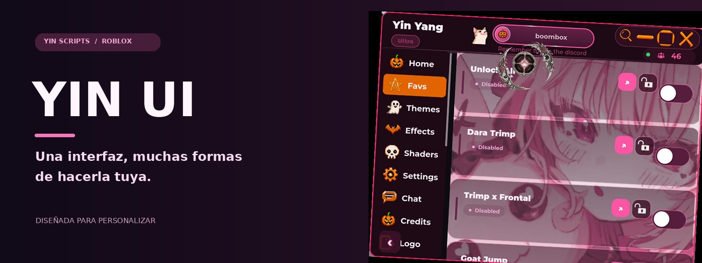
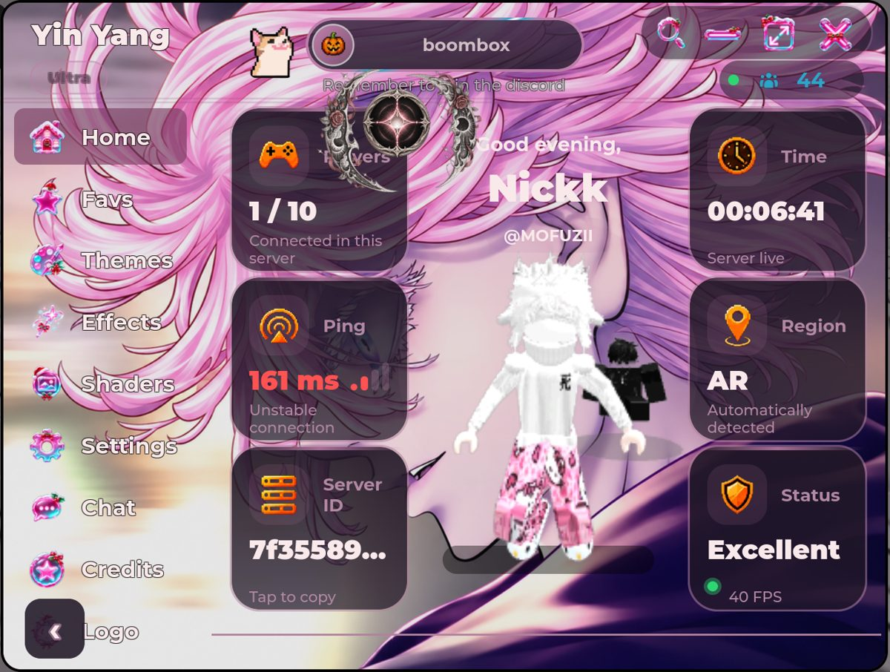
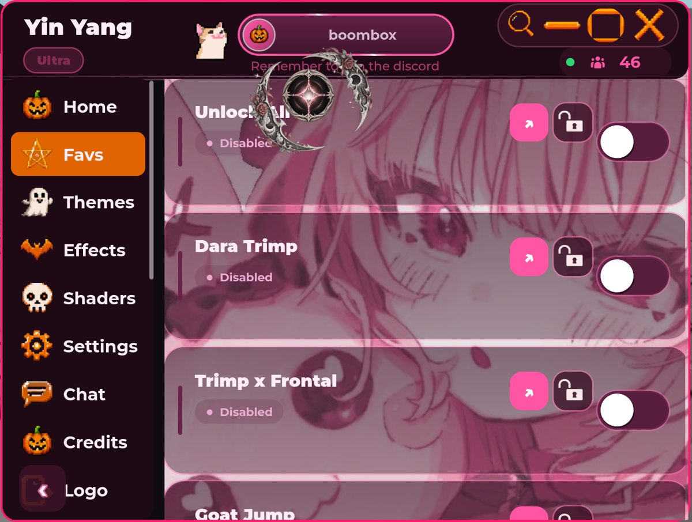
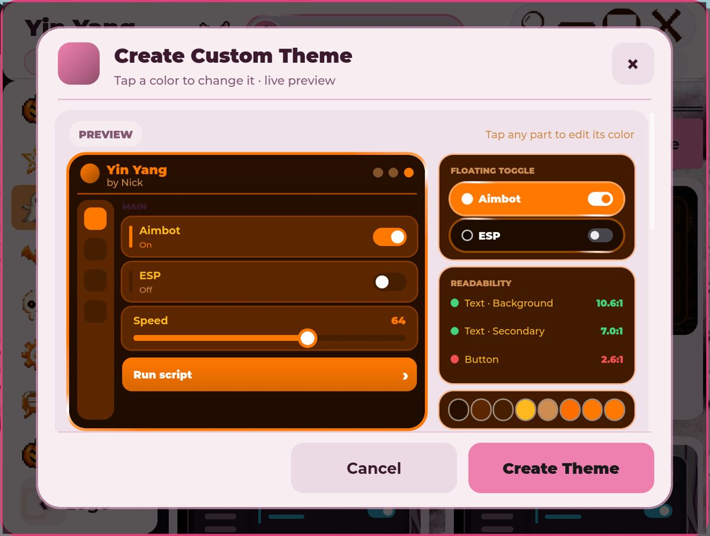
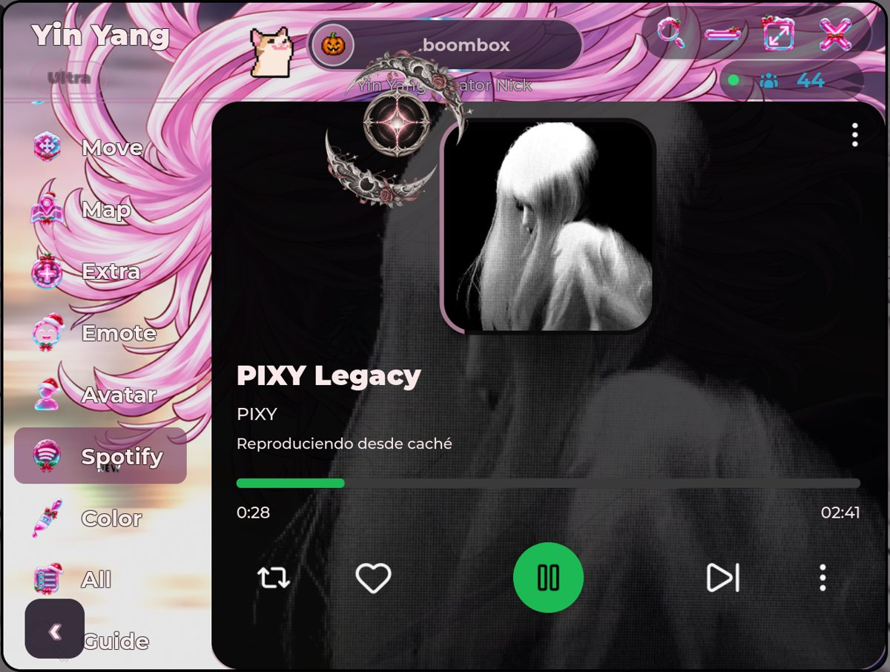

<div align="center">



# Yin UI ✨

**Una librería de interfaces para Roblox creada por YinScripts.**  
Una base para construir experiencias visuales con personalidad.

[Explorar las capturas](#un-vistazo-a-yin-yang) · [Cargador](#cargador) · [Organización](#organización-del-proyecto) · [Licencia](#licencia)

</div>

---

## Un vistazo a Yin Yang

Estas capturas muestran **Yin Yang**, una interfaz que utiliza Yin UI. Son ejemplos de su apariencia y personalización: las funciones propias de Yin Yang, como su reproductor, dependen del proyecto que las integra.

<table>
<tr><td width="50%"><br><b>Una interfaz con personalidad</b><br>Una ventana con navegación y secciones visuales.</td><td width="50%"><br><b>Estilos para cada gusto</b><br>Colores, fondos y una identidad visual propia.</td></tr>
<tr><td width="50%"><br><b>Personalización</b><br>Ejemplo del editor de temas de Yin Yang.</td><td width="50%"><br><b>Una experiencia integrada</b><br>Ejemplo de una sección creada para el proyecto.</td></tr>
</table>

## Cargador

La versión principal de la librería se encuentra en `main`:

```lua
loadstring(game:HttpGet("https://raw.githubusercontent.com/YinScripts/Yin-UI/refs/heads/main/loader.lua"))()
local YinUI = _G.YinYang
```

La versión principal incluye las mejoras probadas para reducir el tirón de la interfaz y descargar los fragmentos en paralelo.

La librería queda disponible en `_G.YinYang`; la interfaz y sus funciones se configuran desde el proyecto que la utiliza. Consulta la [guía de uso y controles](docs/GUIA.md) para ver ejemplos. La disponibilidad de `loadstring` y `game:HttpGet` depende del entorno de ejecución.

Chat y Fan Art son opcionales: actívalos con `CreateWindow("Mi interfaz", "Senju", {Chat = true, FanArt = true})` o créalos después con sus métodos. Créditos siempre se incluye y admite contenido adicional; la guía explica cómo hacerlo.

## Organización del proyecto

- `src/modules/` contiene el código fuente separado por partes.
- `dist/partes/` contiene los fragmentos que descarga el cargador.
- `loader.lua` reúne los fragmentos y ejecuta la librería.
- `construir.py` reconstruye la distribución desde el código fuente.

Los archivos fuente se ensamblan para ejecutarse con un contexto compartido; no son módulos independientes en tiempo de ejecución. Si se reconstruye la distribución, hay que comprobar que la cantidad de fragmentos coincida con la indicada en el cargador.

## Licencia

Copyright © YinScripts. Todos los derechos reservados. Se permite usar y ejecutar la versión original; la publicación o distribución de versiones modificadas requiere autorización previa. Consulta [LICENSE](LICENSE) para leer los términos completos.

---

<div align="center">
Hecho por <b>YinScripts</b> ✨
</div>
